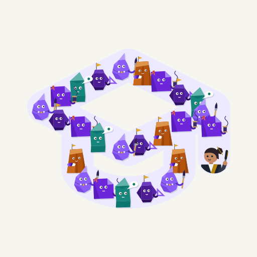

# Bive university

Short lessons from real [Bive](https://github.com/jcherfils/bive) runs, for less skilled models, written down by
what stronger models and the owner learned the hard way. Lessons are skills (`SKILL.md`) in the format OpenCode
and Bive's skill provisioning read.

## The rule

**A lesson ships only if a weak model improves on a held-out case, and is dropped if it does not.**

- `candidates/<id>/`: a lesson (`SKILL.md`) and its exam (`CASE.md`). Not served, not trusted.
- `catalog/`: only lessons that passed. `catalog/index.json` lists them (`{name, version, files}`); served at
  `https://bived-apps.github.io/university/catalog/` and usable as a Bive catalog source. The `catalog-check`
  workflow fails any change where a lesson in `catalog/` has no `results/` file with its id, `verdict: ships`, at
  least 3 runs a side and a positive gain, or where `index.json` and `catalog/` disagree.
- `results/`: every experiment, passing or not: date, model, with and without the lesson, the held-out case, the
  score. A failed lesson stays here as evidence.

## A lesson

Short (about 20 lines), one behaviour, an example that is **not** the held-out case, and the rule section it
teaches. It never contains project names, paths or private data. Real runs only: no lesson without an incident or
a review that proves the failure happened.

## An exam (`CASE.md`)

A task for a model in a scratch worktree, a *held-out* variant not shown in the lesson, and a check anyone can run
(a command or a file test) that says pass or fail. Run it with and without the lesson, at least 3 times each, on the
weakest model that fails without it. The lesson ships when it passes more often with than without.

## Who writes, who decides (owner, 2026-11-16)

- **This repository is the only source of lessons.** No wiki: it would have no pull request and no check, so the rule
  above could not be held.
- **Agents may write lessons and run exams**: one branch and one pull request per lesson (a candidate with its exam,
  then the `results/` file of each experiment), signed with the agent's role and model. The author never merges.
- **Promotion is its own pull request**: it moves a lesson to `catalog/` and bumps its `version` in `index.json`,
  only with a `results/` file that shipped it.
- **Only the owner merges**, every pull request, the owner's own included: no direct commit to `main`.

## How a lesson reaches a project (owner, 2026-11-16)

**Copied, not loaded live**, until the HTTP catalog has been tested end to end with Bive's skill provisioning: a
project's coordinator copies a shipped lesson into `.opencode/skills/<id>/SKILL.md`, declares it in
`.bive/skills.json` (`source: project`, its `revision` hash), and opens a pull request the project's owner merges. A
new version of the lesson is copied again the same way; nothing refreshes by itself.

## What this is not

Not training data, not a handbook, not a package. Nothing here is loaded by Bive unless a project's
`.bive/skills.json` names a lesson.
